# Architecture

```
apps/desktop    Electron shell: window, menu, security policy, installers
apps/web        React + Vite UI (served by the local server inside the app)
packages/server Fastify API on 127.0.0.1, repositories, search, study, import/export, vault
packages/jsonstore  standalone storage engine (atomic writes, watcher, backups, codec) - no app code
packages/shared Zod schemas, constants, pure logic (study engine, Notion parsing, wiki links)
starter-pack/   original MIT content that can be loaded on first run
e2e/            Playwright tests that drive the real Electron app
```

## Process model

The desktop main process starts `startServer` (packages/server) on an ephemeral loopback port with a per-launch bearer
token and opens a sandboxed window that loads the UI from that server. The preload script exposes only the port and
token plus a few folder helpers. There is no remote content.

`startServer` owns one listening socket and swaps between two apps: the **open** app (full API) and, for an
encrypted library that has no key yet, a **locked** app (UI shell, `/vault/unlock`, and `423` for everything else).
Unlocking builds a context with the keyed codec and swaps in the full app; locking swaps back and drops the key.

## Storage

- `JsonStore` / `JsonFile`: validated, versioned, atomically written shards with a keyed mutex per file, a watcher
  for hand edits, quarantine plus restore-from-backup for corrupt files, and multi-file transactions with rollback.
- A `Codec` sits between memory and disk. The default is the identity; the AES-GCM codec encrypts each file. Anything
  that reads or writes outside the store (templates, attachments, import records, logs, notes) goes through the same
  codec.
- `Repo` objects (`JsonRepo`, `NoteRepo`) keep entities in memory and emit change events; search, links and the SSE
  stream listen to those events. Search (MiniSearch) and the link graph are rebuilt in memory at start-up.

## Import and export

Importers build a **plan** (pure, no writes): Notion export, Notion API (reads the workspace into a virtual export,
then the same planner), CSV, Markdown folder, JSON backup. `commitPlan` applies a plan after taking a backup and
writes a manifest so `undoImport` can reverse it. Imports are idempotent through stable `importRef`s.

## UI

React Router (hash routes), TanStack Query for server state, Zustand for UI state. Lists virtualise; note bodies are
fetched on open (list responses omit them). A `VaultGate` shows the unlock screen on `423`.

## Testing

Vitest runs node tests (storage, API, importers, study engine, vault, starter pack) and jsdom tests (UI). Playwright
launches the built Electron app for the end-to-end flows, including an axe accessibility audit of every page in both
themes.


## Diagram

```mermaid
%% Generated by https://gitdiagram.com/reeper316099/cipherkeep
flowchart TD

subgraph group_clients["User interfaces"]
  node_desktop["Desktop shell<br/>[main.ts]"]
  node_webapp["Application routes<br/>[App.tsx]"]
  node_commandlib["Command library<br/>[CommandLibrary.tsx]"]
  node_knowledge["Learning records<br/>[ConceptsPage.tsx]"]
  node_labs["Lab journal<br/>[LabsPage.tsx]"]
  node_studyui["Study review<br/>[StudyPage.tsx]"]
  node_graphui["Knowledge graph<br/>[GraphPage.tsx]"]
  node_dashboard["Dashboard<br/>[Dashboard.tsx]"]
  node_importui["Import interface<br/>[ImportPage.tsx]"]
  node_vaultui["Vault gate<br/>[VaultGate.tsx]"]
  node_api_client["HTTP client<br/>[api.ts]"]
end

subgraph group_server["Local API"]
  node_api_server["Fastify API<br/>[app.ts]"]
  node_vault_routes["Vault routes<br/>[vault-routes.ts]"]
  node_repo["Entity repository<br/>[repo.ts]"]
  node_search["Entity search<br/>[search.ts]"]
end

subgraph group_domain["Learning domain"]
  node_shared["Shared schemas<br/>[schemas.ts]"]
  node_study_engine["Study engine<br/>[cards.ts]"]
end

subgraph group_persistence["Local data"]
  node_jsonstore[("JSON file store<br/>[store.ts]")]
end

subgraph group_integrations["Import and export"]
  node_notion_markdown["Notion parsing<br/>[markdown.ts]"]
  node_import_pipeline["Import planning<br/>[index.ts]"]
  node_notion_api["Notion API importer<br/>[notion-api.ts]"]
  node_exporter["Vault export<br/>[export.ts]"]
  node_starter["Starter pack<br/>[starter.ts]"]
end

node_user(("Learner"))
node_notion_service["Notion workspace"]

node_user -->|"launches"| node_desktop
node_user -->|"uses"| node_webapp
node_desktop -->|"starts local API"| node_api_server
node_webapp -->|"routes to"| node_commandlib
node_webapp -->|"routes to"| node_knowledge
node_webapp -->|"routes to"| node_labs
node_webapp -->|"routes to"| node_studyui
node_webapp -->|"routes to"| node_graphui
node_webapp -->|"routes to"| node_dashboard
node_webapp -->|"routes to"| node_importui
node_webapp -->|"gates routes"| node_vaultui
node_commandlib -.->|"requests data"| node_api_client
node_knowledge -->|"reads and saves"| node_api_client
node_labs -->|"reads and saves"| node_api_client
node_studyui -->|"requests review"| node_api_client
node_importui -.->|"submits imports"| node_api_client
node_vaultui -.->|"manages vault"| node_api_client
node_api_client -->|"HTTP requests"| node_api_server
node_api_server -->|"queries entities"| node_repo
node_api_server -->|"registers routes"| node_vault_routes
node_repo -->|"uses storage"| node_jsonstore
node_api_server -->|"builds import plan"| node_import_pipeline
node_api_server -->|"exports vault"| node_exporter
node_api_server -->|"uses importer"| node_notion_api
node_api_server -.->|"loads starter content"| node_starter
node_search -->|"searches records"| node_repo
node_studyui -->|"uses study logic"| node_study_engine
node_import_pipeline -.->|"parses Markdown"| node_notion_markdown
node_notion_api -.->|"reads workspace"| node_notion_service
node_api_server -.->|"validates domain data"| node_shared
node_api_server -.->|"reads and writes files"| node_jsonstore

click node_desktop "https://github.com/reeper316099/cipherkeep/blob/main/apps/desktop/src/main.ts"
click node_webapp "https://github.com/reeper316099/cipherkeep/blob/main/apps/web/src/App.tsx"
click node_commandlib "https://github.com/reeper316099/cipherkeep/blob/main/apps/web/src/features/commands/CommandLibrary.tsx"
click node_knowledge "https://github.com/reeper316099/cipherkeep/blob/main/apps/web/src/features/concepts/ConceptsPage.tsx"
click node_labs "https://github.com/reeper316099/cipherkeep/blob/main/apps/web/src/features/labs/LabsPage.tsx"
click node_studyui "https://github.com/reeper316099/cipherkeep/blob/main/apps/web/src/features/study/StudyPage.tsx"
click node_graphui "https://github.com/reeper316099/cipherkeep/blob/main/apps/web/src/features/graph/GraphPage.tsx"
click node_dashboard "https://github.com/reeper316099/cipherkeep/blob/main/apps/web/src/features/dashboard/Dashboard.tsx"
click node_importui "https://github.com/reeper316099/cipherkeep/blob/main/apps/web/src/features/import/ImportPage.tsx"
click node_vaultui "https://github.com/reeper316099/cipherkeep/blob/main/apps/web/src/features/vault/VaultGate.tsx"
click node_api_client "https://github.com/reeper316099/cipherkeep/blob/main/apps/web/src/lib/api.ts"
click node_api_server "https://github.com/reeper316099/cipherkeep/blob/main/packages/server/src/app.ts"
click node_vault_routes "https://github.com/reeper316099/cipherkeep/blob/main/packages/server/src/vault-routes.ts"
click node_repo "https://github.com/reeper316099/cipherkeep/blob/main/packages/server/src/repo.ts"
click node_search "https://github.com/reeper316099/cipherkeep/blob/main/packages/server/src/search.ts"
click node_shared "https://github.com/reeper316099/cipherkeep/blob/main/packages/shared/src/schemas.ts"
click node_study_engine "https://github.com/reeper316099/cipherkeep/blob/main/packages/shared/src/study/cards.ts"
click node_notion_markdown "https://github.com/reeper316099/cipherkeep/blob/main/packages/shared/src/notion/markdown.ts"
click node_import_pipeline "https://github.com/reeper316099/cipherkeep/blob/main/packages/server/src/import/index.ts"
click node_notion_api "https://github.com/reeper316099/cipherkeep/blob/main/packages/server/src/import/notion-api.ts"
click node_exporter "https://github.com/reeper316099/cipherkeep/blob/main/packages/server/src/export.ts"
click node_starter "https://github.com/reeper316099/cipherkeep/blob/main/packages/server/src/starter.ts"
click node_jsonstore "https://github.com/reeper316099/cipherkeep/blob/main/packages/jsonstore/src/store.ts"

classDef toneNeutral fill:#f8fafc,stroke:#334155,stroke-width:1.5px,color:#0f172a
classDef toneBlue fill:#dbeafe,stroke:#2563eb,stroke-width:1.5px,color:#172554
classDef toneAmber fill:#fef3c7,stroke:#d97706,stroke-width:1.5px,color:#78350f
classDef toneMint fill:#dcfce7,stroke:#16a34a,stroke-width:1.5px,color:#14532d
classDef toneRose fill:#ffe4e6,stroke:#e11d48,stroke-width:1.5px,color:#881337
classDef toneIndigo fill:#e0e7ff,stroke:#4f46e5,stroke-width:1.5px,color:#312e81
classDef toneTeal fill:#ccfbf1,stroke:#0f766e,stroke-width:1.5px,color:#134e4a
class node_desktop,node_webapp,node_commandlib,node_knowledge,node_labs,node_studyui,node_graphui,node_dashboard,node_importui,node_vaultui,node_api_client toneBlue
class node_api_server,node_vault_routes,node_repo,node_search toneAmber
class node_shared,node_study_engine toneMint
class node_jsonstore toneRose
class node_notion_markdown,node_import_pipeline,node_notion_api,node_exporter,node_starter,node_user,node_notion_service toneIndigo
```


