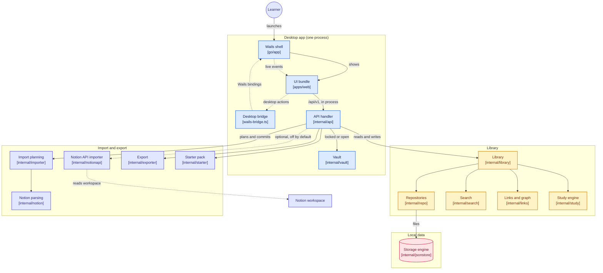

# Architecture

```
go/app             Wails desktop app: window, menu, single instance, the bridge the UI uses for desktop actions
go/internal/api    the /api/v1 HTTP handler (open and locked), vault routes, live events
go/internal/...    storage engine (jsonstore), repositories, search, links, study, importer, exporter, vault
go/cmd/ck-server   the same API on a loopback port, for development and tests
apps/web           React + Vite UI, embedded in the app
packages/shared    constants, schemas and pure logic the UI uses (study engine, wiki links, Notion helpers)
starter-pack/      original MIT content, embedded in the app and loadable on first run
e2e/               Playwright tests of the UI and the Go API in WebKit and Chromium
tests/contract     the API contract tests, run against the Go server
```

## Process model

One process. The Wails window shows the UI bundle from the asset server built into the app. Every request the bundle
does not answer itself (everything under `/api/v1`) goes to the Go API handler, inside the process: there is no
network port, so there is nothing for another program to reach and no token to protect. The UI calls the Go side
directly only for desktop actions (open a link in the browser, show a file in the folder, pick a folder, move the data
folder), through the Wails bindings that `apps/web/src/lib/wails-bridge.ts` turns into `window.cipherkeep`.

`api.Server` owns the data folder (an instance lock) and serves one of two handlers: the **open** handler (the full
API) or, for an encrypted library that has no key yet, the **locked** handler (status, `/vault/unlock`, and `423` for
everything else). Unlocking opens the library with the keyed codec and swaps in the open handler; locking swaps back,
closes the library and drops the key. During an encryption change other requests get `503 BUSY`.

Live updates (an edit made in another editor, an import) reach the window as Wails events. The same events are also
served as a server-sent event stream for the loopback server.

## Storage

- `jsonstore`: validated, versioned, atomically written JSON files with a lock per file, a watcher for hand edits,
  quarantine plus restore-from-backup for corrupt files, transactions with rollback, and zip backups.
- A codec sits between memory and disk. The plain codec stores files as they are; the AES-256-GCM codec encrypts each
  file. Everything written outside the store (templates, attachments, import records, logs, notes) goes through the
  same codec.
- Repositories (JSON shards, and Markdown notes) keep entities in memory and report changes; search, links and live
  events listen to them. The search index (BM25 with prefix and typo matching) and the link graph are built in memory
  when the library opens. In the desktop app, watching for hand edits starts right after the library is shown.

## Import and export

Importers build a **plan** (pure, no writes): Notion export, Notion API (reads the workspace into a virtual export,
then the same planner), CSV, Markdown folder, JSON backup. Commit applies a plan after taking a backup and writes a
manifest so the import can be undone. Imports are idempotent through stable `importRef`s.

## UI

React Router (hash routes), TanStack Query for server state, Zustand for UI state. Lists virtualise; note bodies are
fetched on open (list responses omit them). A `VaultGate` shows the unlock screen on `423`.

## Testing

- **Go** (`go test -race ./...` in `go/`): the storage engine, repositories, search, study, importers, exporters, API,
  vault and shell logic, including parity tests against results recorded from the Node version (`fixtures/compat`)
  and a test that opens libraries written by the Node app, plain and encrypted.
- **Vitest** (`npm test`): the UI (jsdom), `packages/shared`, and the API contract tests (`tests/contract`), which start
  the Go server.
- **Playwright** (`npm run e2e`): the UI the app embeds and the Go API, in WebKit and Chromium: first run, import,
  study, restart, a hand edit, encryption, and an axe accessibility audit of every page in both themes.
- **Smoke test** (`npm run app:smoke`): the built desktop app, with its window hidden, on all three systems in CI.

## Diagram


